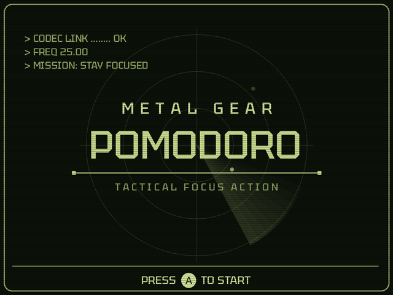
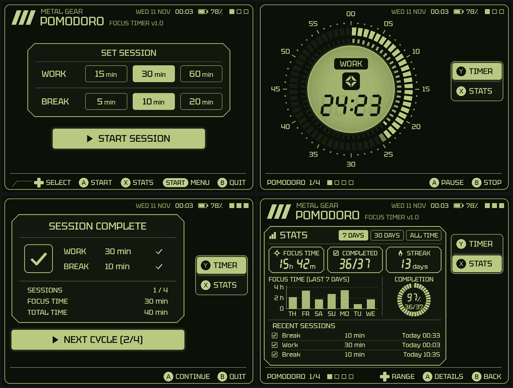

# Metal Gear Pomodoro

A Pomodoro focus timer for the **Anbernic RG35XXSP** (muOS + PortMaster), written in **LÖVE 11.5**.
Green-LCD codec look, a 60-minute dial with a seconds ring, rounds in sets of 4, and stats.




## Features
- Work 15 / 30 / 60 min, break 5 / 10 / 20 min. The break starts by itself; rounds come in sets of 4.
- Dial: lit segments = minutes left, inner ring = seconds left in the current minute.
- Stats: focus time, completed sessions, streak, 7-day / 30-day / all-time chart, session history.
- Keeps the screen awake while the timer runs (muOS idle timeouts are restored afterwards).
- Lid close: keep counting real time or pause (setting).
- Status bar: date, time and battery.
- Sounds: round finished, set finished, menu navigation, plus a synthesized bell at the end of work.
- Fully controller-driven; a one-time A press on the title screen learns the button layout.

## Controls
| Button | Action |
|---|---|
| D-pad | Move / change values |
| A / B | Confirm / back (swappable in Settings) |
| X / Y | Stats / timer |
| Start | Menu |
| Select | Sound on/off |
| Start + Select | Quit |

PC keyboard: arrows = D-pad, X = A, Z = B, S = X, A = Y, Enter = Start, Right Shift = Select, Esc = quit.

## Run on a Mac
Install [LÖVE 11.5](https://github.com/love2d/love/releases/tag/11.5) (not 12), then:
```bash
/Applications/love.app/Contents/MacOS/love metalgearpomodoro/lovegame --fast   # --fast: 1 min = 1 s
```

## Install on the device (muOS)
```bash
DEVICE=root@<device-ip>
scp -r metalgearpomodoro "$DEVICE:/mnt/mmc/ports/"
scp "Metal Gear Pomodoro.sh" "$DEVICE:/mnt/mmc/ROMS/Ports/"
ssh "$DEVICE" 'chmod +x "/mnt/mmc/ROMS/Ports/Metal Gear Pomodoro.sh"'
```
Launch from Explore Content → Ports. Needs PortMaster's `love_11.5` runtime.
Fast test over SSH: `killall -q frontend.sh muxlaunch; POMODORO_FAST=1 bash "/mnt/mmc/ROMS/Ports/Metal Gear Pomodoro.sh"`.
Log: `/mnt/mmc/ports/metalgearpomodoro/log.txt`. Saves: `metalgearpomodoro/conf/love/pomodoro/`.

## Layout
```
Metal Gear Pomodoro.sh        PortMaster launcher
metalgearpomodoro/lovegame/
  main.lua, conf.lua          app entry and LÖVE config
  app/                        this app: screens, theme, timer, stats, sounds
  kit/                        reusable starter kit for other LÖVE apps:
                              input, ui, save + json, scale, loop, suspend,
                              keepawake, status, log
  assets/fonts/               Tektur (SIL Open Font License, see Tektur-OFL.txt)
  assets/sounds/              round / set / navigation sounds (OGG)
```

## Notes
- Fan project, not affiliated with Konami. "Metal Gear" is a Konami trademark; fine for personal use,
  rename it before publishing anywhere.
- The Tektur font is licensed under the SIL Open Font License 1.1 (`assets/fonts/Tektur-OFL.txt`).
